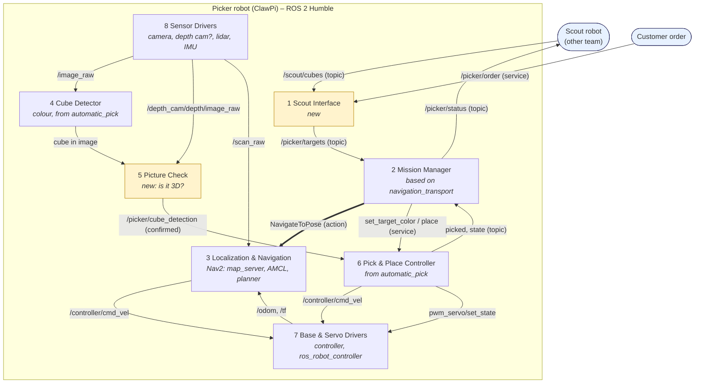

# Picker Robot (ClawPi) – Software Architecture

Issue: Design the high-level software architecture for the Hiwonder ClawPi (Picker robot).
Owner: badri · Status: draft v1 · Reviewer: _TBD (another team member)_

## 1. Goal

From the customer brief: on an order, the Picker fetches the cubes that Scout found and brings
them to the drop zone, **without driving over anything** and **without being fooled by pictures**.
Scout finds, Picker fetches.

## 2. Sources and assumptions

- Based on the Hiwonder ClawPi repo (github.com/Hiwonder/ClawPi), mainly the demo
  `src/example/example/navigation_transport/` (`navigation_transport.py`, `automatic_pick.py`)
  and the `navigation`, `driver` and `peripherals` packages.
- Topic names marked **(ClawPi)** come from that code. Names marked **(proposed)** are our
  design and can change.
- Sensors must be confirmed in `docs/robot.md` / Hiwonder wiki. The repo has launch files for a
  USB camera, depth camera, lidar and IMU, but a launch file alone does not prove ClawPi has the part.
- The message format between Scout and Picker is an **assumption** until both teams agree an
  interface contract.
- The robot works on a map of the warehouse that Nav2 can load (from Scout or made by us).

## 3. Components and responsibilities

| # | Component (ROS 2 node/s) | Responsibility | Based on |
|---|---|---|---|
| 1 | **Scout Interface** | Receives the order and the cube positions (x, y, colour) from Scout. Passes them to the Mission Manager. Reports status back to Scout. | **new** |
| 2 | **Mission Manager** | The "boss". Runs the job step by step: take next cube → drive to it → pick → drive to drop zone → place → next cube. Handles failures (cube not found, pick failed). | `navigation_transport.py` |
| 3 | **Localization & Navigation** | Knows where the robot is on the map. Plans a path and drives to a goal while avoiding obstacles. | Nav2: `map_server`, `amcl`, planner, controller (`navigation` package) |
| 4 | **Cube Detector** | Finds the cube in the camera image (by colour) and gives its position in the image. | `automatic_pick.py` (vision part) |
| 5 | **Picture Check** | Confirms the detected cube is a real 3D object and not a flat picture, before picking. | **new** |
| 6 | **Pick & Place Controller** | Fine-aligns the robot to the cube, then moves the arm and gripper to pick and later to place. | `automatic_pick.py` (state machine + servos) |
| 7 | **Base & Servo Drivers** | Turns drive commands into wheel speeds, publishes odometry, and sets the 4 PWM servos (pitch, yaw, arm lift, gripper). | `controller` (`odom_publisher_node`), `ros_robot_controller` |
| 8 | **Sensor Drivers** | Publish camera images, lidar scans and IMU data. | `peripherals` |

Safety stop behaviour is defined in the team safety protocol, which the instructor checks.

## 4. Communication between components

ROS 2 has three ways for nodes to talk:
- **Topic** – a stream of messages; one node publishes, any node can listen.
- **Service** – a question and one answer (short jobs).
- **Action** – a long job with feedback and a final result (e.g. "drive to this point").

| From → To | Type | Name | Message type | What is sent |
|---|---|---|---|---|
| Scout → Scout Interface | Topic | `/scout/cubes` (proposed) | custom `CubeList` (proposed: id, colour, x, y, real_object yes/no) | Cubes Scout found on the map |
| Customer / operator → Scout Interface | Service | `/picker/order` (proposed) | custom `Order` (proposed: list of cube colours or ids) | The order to fetch |
| Scout Interface → Mission Manager | Topic | `/picker/targets` (proposed) | custom `CubeList` | Cubes to fetch, in order |
| Mission Manager → Scout / team | Topic | `/picker/status` (proposed) | `std_msgs/String` | e.g. `DRIVING_TO_CUBE 2`, `PICKED 2`, `DONE` |
| Mission Manager → Navigation | Action | `navigate_to_pose` (Nav2) | `nav2_msgs/action/NavigateToPose` | Goal: cube position or drop zone; result: reached / failed |
| Mission Manager → Pick & Place | Service | `automatic_pick/set_target_color`, `set_running`, `place` (ClawPi) | `interfaces/SetString`, `std_srvs/SetBool` | Start picking a colour, start placing |
| Pick & Place → Mission Manager | Topic | `automatic_pick/picked`, `automatic_pick/state_topic` (ClawPi) | `std_msgs/Bool`, `std_msgs/String` | Cube held yes/no; current state |
| Sensors → Cube Detector | Topic | `/image_raw` (ClawPi, USB cam) | `sensor_msgs/Image` | Colour image |
| Sensors → Picture Check | Topic | `/depth_cam/depth/image_raw` (ClawPi, *if ClawPi has a depth camera*) | `sensor_msgs/Image` | Distance per pixel |
| Cube Detector → Picture Check → Pick & Place | Topic | `/picker/cube_detection` (proposed) | custom (proposed: x, y in image, size, is_3d) | Cube seen and confirmed real |
| Pick & Place → Drivers | Topic | `/controller/cmd_vel` (ClawPi) | `geometry_msgs/Twist` | Small moves to line up with the cube |
| Pick & Place → Drivers | Topic | `/ros_robot_controller/pwm_servo/set_state` (ClawPi) | `ros_robot_controller_msgs/SetPWMServoState` | Arm and gripper positions |
| Navigation → Drivers | Topic | `/controller/cmd_vel` (ClawPi, via Nav2 velocity smoother) | `geometry_msgs/Twist` | Drive speed while navigating |
| Sensors → Navigation | Topic | `/scan_raw` (ClawPi, lidar) | `sensor_msgs/LaserScan` | Obstacles + localization (AMCL) |
| Drivers → Navigation | Topic | `/odom`, `/tf` (ClawPi) | `nav_msgs/Odometry`, `tf2_msgs/TFMessage` | Where the robot moved |

**How the two customer rules are covered**
- *Not driving over anything*: Nav2 builds a costmap from the lidar (`/scan_raw`) and plans around
  obstacles. Small cubes may be **below the lidar's scan height**, so the Mission Manager also adds the
  known cube positions from Scout as obstacles to avoid (proposed; needs testing on the robot).
- *Not fooled by pictures*: the Picture Check only lets a pick start if the cube has real height
  (depth camera: the cube is closer than the floor around it). If ClawPi has no depth camera, the
  fallback is Scout's `real_object` flag. To decide after `docs/robot.md` is confirmed.

**Main flow (one cube)**
1. Order arrives → Scout Interface matches it with Scout's cube list → sends targets.
2. Mission Manager sends a `NavigateToPose` goal near the cube.
3. Nav2 drives there; result = reached.
4. Mission Manager starts Pick & Place for that colour.
5. Cube Detector finds the cube → Picture Check confirms it is real → Pick & Place lines up and grips.
6. `picked = true` → Mission Manager sends a `NavigateToPose` goal to the drop zone.
7. At the drop zone → `place` service → gripper opens → status `PLACED`.
8. Next cube, or `DONE`.

If a step fails (goal not reached, cube not seen, picture detected, pick failed), the Mission Manager
reports it on `/picker/status` and moves to the next cube.

## 5. Architecture diagram

Also saved as `architecture.png`. GitHub shows the Mermaid code below as a diagram.

Legend: yellow = new component we build; blue = outside the Picker; thick arrow = ROS 2 action.

## 6. How the design fits ROS 2

- **Each component is a ROS 2 node** (or a small group of nodes, e.g. Nav2). Nodes are independent
  programs that only talk through topics, services and actions, so each teammate can build and test
  one node alone.
- **Packages**: we reuse ClawPi packages (`driver`, `peripherals`, `navigation`, `interfaces`) and put
  our own code in one new package, e.g. `picker_mission` (Scout Interface, Mission Manager, Picture
  Check), plus `picker_msgs` for the custom messages (`CubeList`, `Order`, detection).
- **Launch**: one launch file `picker.launch.py` starts sensors, drivers, Nav2 (`navigation.launch.py`)
  and our nodes — the same pattern as ClawPi's `navigation_transport.launch.py`.
- **Actions for long jobs**: driving is a Nav2 action, so the Mission Manager gets feedback and can
  cancel a goal (useful for a safety stop).
- **TF and map**: Nav2 uses the TF tree (`map → odom → base_footprint`) and a map from `map_server`.
  Scout's cube positions must use the **same map frame**, which is part of the interface contract.
- **Laptop first**: because every part is a node, the design can run on a laptop in Gazebo
  (ClawPi `simulations` package) in ROS 2 Humble before the robot arrives in S4.
- **Between teams**: Scout (MentorPi) and Picker (ClawPi) share topics over the same network with the
  same `ROS_DOMAIN_ID`. Topic names and message types go in the interface contract.

## 7. Open questions (for PO / Scout team)

- Does ClawPi have a depth camera? (check `docs/robot.md`) → decides the Picture Check.
- Interface contract with Scout: topic names, message fields, map frame.
- Who sends the order (customer GUI, command line, Scout)?
- Where is the drop zone (fixed pose on the map)?
